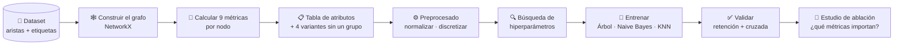
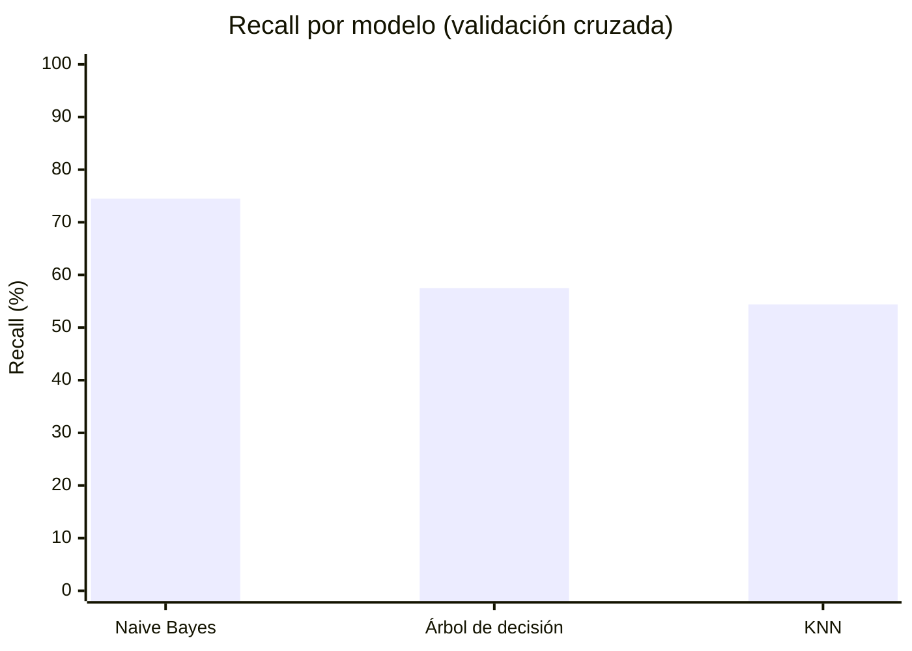

<div align="center">

# 🕸️ Aprendizaje Automático Relacional

### ¿Se puede saber a qué se dedica un desarrollador solo por cómo está conectado?

Clasificación de nodos en una red social de desarrolladores de GitHub usando **únicamente métricas estructurales del grafo** como variables de entrada.

*Proyecto de la asignatura de Inteligencia Artificial · Grado en Ingeniería Informática · Universidad de Sevilla (2024)*

<br/>


</div>

---

## 📖 Índice

- [El problema](#-el-problema)
- [El dataset](#-el-dataset)
- [Metodología](#-metodología)
- [Métricas del grafo](#-métricas-del-grafo)
- [Modelos](#-modelos)
- [Resultados](#-resultados)
- [Qué métricas importan](#-qué-métricas-importan)
- [Conclusiones](#-conclusiones)
- [Estructura del repositorio](#-estructura-del-repositorio)
- [Cómo ejecutarlo](#-cómo-ejecutarlo)
- [Autoras](#-autoras)

---

## 🎯 El problema

En el aprendizaje automático clásico, cada ejemplo se describe con sus propios atributos. En el **aprendizaje automático relacional**, en cambio, los datos forman una red, y lo importante es **cómo se relacionan** los elementos entre sí.

La pregunta de este proyecto es:

> Si solo sabemos **con quién se conecta** cada desarrollador en GitHub, sin ver su código ni su perfil, ¿podemos predecir si se dedica al **desarrollo web** o al **machine learning**?

Para responderla, calculamos métricas que describen la posición de cada usuario en la red y las usamos como entrada de tres modelos de clasificación supervisada.

---

## 📊 El dataset

Usamos **[GitHub Social Network (musae_git)](https://snap.stanford.edu/data/github-social.html)**, de Stanford SNAP: una red de desarrolladores de GitHub donde dos usuarios están conectados si se siguen mutuamente.

| | Valor |
|---|---|
| 👤 **Nodos** (desarrolladores) | 37.700 |
| 🔗 **Aristas** (seguimiento mutuo) | 289.003 |
| 🌐 **Clase 0** · desarrollo web | 74,2 % |
| 🤖 **Clase 1** · machine learning | 25,8 % |

| Archivo | Contenido |
|---|---|
| `musae_git_edges.csv` | Las conexiones: `id_1`, `id_2` |
| `musae_git_target.csv` | Los usuarios: `id`, `name` y la etiqueta a predecir `ml_target` |

> ⚖️ Las clases están **desbalanceadas**: hay tres desarrolladores web por cada uno de machine learning. Por eso la métrica principal es el **recall** de la clase minoritaria: un modelo que dijera siempre "web" acertaría el 74 % de las veces sin aprender nada.

---

## 🧪 Metodología



1. **Construir el grafo** a partir de las aristas con NetworkX.
2. **Calcular las métricas estructurales** de cada nodo y guardarlas en CSV (`Tool/Metricas.ipynb`).
3. **Unir todo en una tabla** de atributos y generar cuatro variantes, cada una sin un grupo de métricas (`Tool/Tablas.ipynb`).
4. **Preprocesar** según el modelo: normalización y, para Naive Bayes, discretización.
5. **Buscar los mejores hiperparámetros** con búsqueda en rejilla (`GridSearchCV`) optimizando el recall.
6. **Validar** con dos métodos: retención (80 % entrenamiento, 20 % prueba, estratificado) y validación cruzada de 10 particiones.
7. **Estudio de ablación:** entrenar con cada variante de la tabla para ver qué grupo de métricas aporta información y cuál solo añade ruido.

---

## 📐 Métricas del grafo

Calculadas con NetworkX y agrupadas en cuatro familias:

| Familia | Métrica | Qué mide |
|---|---|---|
| 🎯 **Centralidad** | Cercanía (*closeness*) | Lo cerca que está un nodo de todos los demás |
| | Intermediación (*betweenness*) | Cuántas veces un nodo hace de puente en los caminos más cortos |
| | Grado (*degree*) | Cuántas conexiones directas tiene |
| 🔺 **Agrupamiento** | Coeficiente de agrupamiento | Qué proporción de sus vecinos están conectados entre sí |
| | Triángulos | En cuántos triángulos participa |
| | Cuadrados (*square clustering*) | Cuánto participa en estructuras de cuatro nodos |
| 🧅 **Núcleo** | K-Core | El mayor *k* tal que el nodo pertenece a un subgrafo donde todos tienen al menos *k* conexiones |
| 👥 **Comunidad** | Modularidad voraz (*greedy modularity*) | Grupo de nodos densamente conectados entre sí |
| | Propagación asíncrona de etiquetas (*asyn LPA*) | Comunidades detectadas propagando etiquetas entre vecinos |

---

## 🤖 Modelos

| Modelo | Preprocesado | Hiperparámetros explorados | Mejor configuración |
|---|---|---|---|
| 🌳 **Árbol de decisión** | Normalización | Profundidad máxima · mínimo de muestras para dividir | `max_depth=5` · `min_samples_split=5` |
| 🎲 **Naive Bayes** (categórico) | Normalización + discretización en 500 intervalos | Suavizado de Laplace (`alpha`) | `alpha=1` |
| 📍 **KNN** | Normalización | Número de vecinos · métrica de distancia | `k=1` · distancia Manhattan |

---

## 📈 Resultados

Recall de la clase *machine learning* con la mejor configuración de cada modelo:

| Modelo | Recall (validación cruzada) |
|---|:-:|
| 🎲 **Naive Bayes** | **🏆 74,5 %** |
| 🌳 Árbol de decisión | 57,5 % |
| 📍 KNN | 54,4 % |



<details>
<summary><b>🌳 Detalle: Árbol de decisión</b></summary>

<br/>

Comparación de configuraciones con validación por retención:

| `max_depth` | `min_samples_split` | Recall |
|:-:|:-:|:-:|
| 3 | 3 | 56,3 % |
| 5 | 5 | 55,5 % |
| 10 | 10 | 54,1 % |

Los árboles muy profundos tienden a sobreajustarse. El árbol entrenado se puede ver en [`Modelos/arbol_de_decision.png`](Modelos/arbol_de_decision.png).

</details>

<details>
<summary><b>🎲 Detalle: Naive Bayes</b></summary>

<br/>

| Suavizado (`alpha`) | Recall medio (validación cruzada) |
|:-:|:-:|
| **1** | **74,5 %** |
| 3 | 66,1 % |

Aumentar el suavizado empeora el modelo, porque reparte demasiada probabilidad entre intervalos que casi no aparecen en los datos.

</details>

<details>
<summary><b>📍 Detalle: KNN</b></summary>

<br/>

Comparación de configuraciones con validación por retención:

| Vecinos (`k`) | Distancia | Recall |
|:-:|---|:-:|
| 1 | Manhattan | 28,8 % |
| 1 | Euclídea | 28,6 % |
| 3 | Manhattan | 19,3 % |
| 3 | Euclídea | 18,7 % |
| 5 | Manhattan | 13,0 % |

Cuantos más vecinos se consultan, más pesa la clase mayoritaria y peor detecta la minoritaria. Con validación por retención su recall cae mucho respecto a la validación cruzada, señal de que el modelo es poco estable con estos datos.

</details>

---

## 🔬 Qué métricas importan

Para saber qué familias de métricas aportan información, entrenamos cada modelo **quitando un grupo cada vez** y comparamos el recall.

| Atributos usados | 🎲 Naive Bayes | 🌳 Árbol | 📍 KNN |
|---|:-:|:-:|:-:|
| Todos | 74,3 % | 53,7 % | 27,7 % |
| Sin centralidad | 74,8 % ⬆️ | 54,4 % ⬆️ | 26,4 % |
| Sin agrupamiento | 74,2 % | 53,7 % | 26,8 % |
| Sin núcleo | 73,5 % | 53,7 % | 27,8 % |
| **Sin comunidad** | **67,3 % 🔻** | **17,5 % 🔻** | 26,0 % 🔻 |

*Naive Bayes: media de validación cruzada de 10 particiones. Árbol y KNN: validación por retención.*

**Lectura de los resultados:**

- 👥 **Las métricas de comunidad son las más importantes.** Al quitarlas empeoran los tres modelos, y el árbol de decisión pasa de 53,7 % a 17,5 %. Tiene sentido: los desarrolladores de machine learning tienden a seguirse entre ellos y forman sus propios grupos dentro de la red.
- 🎯 **La centralidad añade ruido.** Al quitarla, Naive Bayes y el árbol mejoran ligeramente.
- 🔺🧅 **Agrupamiento y núcleo apenas influyen.** Su efecto es mínimo en todos los modelos.

---

## 💡 Conclusiones

El modelo más prometedor es **Naive Bayes**, por tres motivos:

1. ⚡ **Eficiente:** se entrena y predice muy rápido, algo importante en una red de casi 38.000 nodos.
2. 🎯 **El mejor recall:** detecta alrededor del 74,5 % de los desarrolladores de machine learning.
3. ⚖️ **Robusto ante el desbalance:** funciona bien aunque solo uno de cada cuatro usuarios sea de la clase minoritaria.

En conjunto, el proyecto demuestra que **la estructura de una red contiene información real sobre sus nodos**: sin ver nada del perfil de un usuario, solo su posición en el grafo, se puede predecir su especialidad con un acierto razonable.

---

## 📁 Estructura del repositorio

```
AprendizajeAutomaticoRelacional-G1/
├── Datos/                        # 📂 Dataset original (aristas y etiquetas)
├── Tool/
│   ├── Metricas.ipynb            # 📐 Construye el grafo y calcula las métricas
│   └── Tablas.ipynb              # 📋 Une las métricas y genera las variantes
├── Metricas/                     # Una métrica por CSV
├── Tablas/
│   ├── TablaAtributos.csv        # Todas las métricas
│   └── TablaNo*.csv              # Variantes sin centralidad, agrupamiento, núcleo o comunidad
├── Modelos/
│   ├── ArbolDecision.ipynb       # 🌳 Hiperparámetros, entrenamiento y validación
│   ├── NaiveBayes.ipynb          # 🎲
│   ├── KNN.ipynb                 # 📍
│   └── arbol_de_decision.png     # Visualización del árbol
├── Estudios/                     # 🔬 Estudio de ablación de cada modelo
├── Memoria/Memoria_IA.pdf        # 📄 Memoria del proyecto
└── Presentacion/                 # 🎤 Presentación
```

---

## 💻 Cómo ejecutarlo

**Requisitos:** Python 3.10 o superior.

```bash
# 1. Clonar el repositorio
git clone https://github.com/angelalop03/AprendizajeAutomaticoRelacional-G1.git
cd AprendizajeAutomaticoRelacional-G1

# 2. Instalar dependencias
pip install networkx pandas scikit-learn matplotlib joblib jupyter

# 3. Abrir los notebooks
jupyter notebook
```

**Orden recomendado:**

1. `Tool/Metricas.ipynb` → calcula las métricas del grafo.
2. `Tool/Tablas.ipynb` → construye las tablas de atributos.
3. `Modelos/*.ipynb` → entrena y valida cada modelo.
4. `Estudios/*.ipynb` → compara qué métricas aportan más.

> ⏳ Algunas métricas, como la intermediación y la cercanía, tardan bastante en calcularse sobre casi 300.000 aristas. Los resultados ya están guardados en `Metricas/` y `Tablas/`, así que puedes empezar directamente por los modelos.

---

## 👩‍💻 Autoras

| | |
|---|---|
| **Ángela López Oliva** | [GitHub](https://github.com/angelalop03) · [Portfolio](https://portfolio-v2-rosy-eight.vercel.app/) |
| **Alba González Pineda** | |

Departamento de Ciencias de la Computación e Inteligencia Artificial · Universidad de Sevilla

📄 La explicación completa está en la [memoria del proyecto](Memoria/Memoria_IA.pdf).

<div align="center">

⭐ Si te ha resultado interesante, ¡déjale una estrella al repo!

</div>
